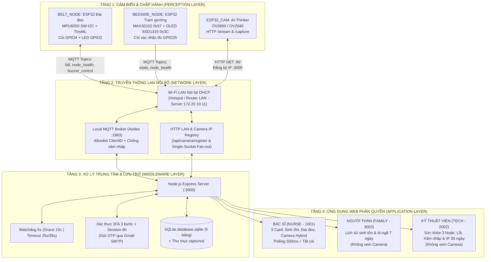
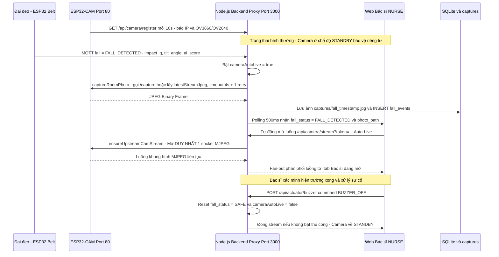

# TÀI LIỆU THUYẾT MINH KỸ THUẬT VÀ ĐẶC TẢ HỆ THỐNG (SYSTEM TECHNICAL SPECIFICATION)

**Tên đề tài:** Hệ thống Giám sát Sức khỏe và Phát hiện Té ngã Người Cao tuổi (IoHT) trên nền tảng Mạng LAN Nội bộ, Edge AI và Phân quyền Bảo mật 2 lớp.

---

## MỤC LỤC TỔNG QUAN
1. [CHƯƠNG 1: TỔNG QUAN KIẾN TRÚC HỆ THỐNG 4 TẦNG](#chương-1-tổng-quan-kiến-trúc-hệ-thống-4-tầng)
2. [CHƯƠNG 2: TẦNG CẢM BIẾN & XỬ LÝ TẠI BIÊN (PERCEPTION & EDGE AI)](#chương-2-tầng-cảm-biến--xử-lý-tại-biên-perception--edge-ai)
3. [CHƯƠNG 3: TẦNG TRUYỀN THÔNG MẠNG LAN NỘI BỘ (NETWORK LAYER)](#chương-3-tầng-truyền-thông-mạng-lan-nội-bộ-network-layer)
4. [CHƯƠNG 4: TẦNG XỬ LÝ TRUNG TÂM, CAMERA HYBRID & BẢO MẬT (MIDDLEWARE LAYER)](#chương-4-tầng-xử-lý-trung-tâm-camera-hybrid--bảo-mật-middleware-layer)
5. [CHƯƠNG 5: TẦNG ỨNG DỤNG WEB RBAC & XÁC THỰC 2 LỚP 2FA (APPLICATION LAYER)](#chương-5-tầng-ứng-dụng-web-rbac--xác-thực-2-lớp-2fa-application-layer)
6. [CHƯƠNG 6: KỊCH BẢN VẬN HÀNH TOÀN TRÌNH (END-TO-END WORKFLOWS)](#chương-6-kịch-bản-vận-hành-toàn-trình-end-to-end-workflows)
7. [CHƯƠNG 7: ĐẶC TẢ MODULE MÃ NGUỒN THỰC TẾ](#chương-7-đặc-tả-module-mã-nguồn-thực-tế)
8. [CHƯƠNG 8: CHỈ TIÊU KỸ THUẬT & MA TRẬN KIỂM THỬ HỆ THỐNG](#chương-8-chỉ-tiêu-kỹ-thuật--ma-trận-kiểm-thử-hệ-thống)
9. [CHƯƠNG 9: HƯỚNG DẪN ĐẤU NỐI PHẦN CỨNG & TRIỂN KHAI VẬN HÀNH](#chương-9-hướng-dẫn-đấu-nối-phần-cứng--triển-khai-vận-hành)

---

# CHƯƠNG 1: TỔNG QUAN KIẾN TRÚC HỆ THỐNG 4 TẦNG

### 1.1. Mục tiêu thiết kế
Hệ thống được xây dựng để giám sát liên tục vận động của người cao tuổi, phát hiện sớm sự cố té ngã tại chỗ, đo chỉ số sinh tồn (nhịp tim `BPM`, nồng độ oxy máu `SpO2`) khi nghỉ tại giường, đồng thời cung cấp công cụ xác minh trực quan cho nhân viên y tế và giám sát an toàn vận hành cho kỹ thuật viên.

Các nguyên tắc cốt lõi của hệ thống thực tế:
1. **Vận hành LAN Nội bộ (Local-first Architecture):** Toàn bộ dữ liệu cảm biến (`MQTT` cổng `1883`), luồng Camera (`HTTP Proxy`), cơ sở dữ liệu (`SQLite`) và Web Dashboard (`HTTP` cổng `3000`) chạy trên mạng Wi-Fi LAN nội bộ (ví dụ mạng Hotspot/Router dải `172.20.10.x`, PC Server tại `172.20.10.11`), không phụ thuộc nền tảng IoT Cloud bên ngoài.
2. **Bảo vệ Quyền riêng tư & Băng thông (Camera Hybrid):** Camera không phát trực tiếp ra ngoài hay mở 24/7 cho mọi đối tượng. Mặc định Camera ở trạng thái chờ (`Standby`), chỉ tự động bật luồng trực tiếp (`Auto-Live`) và chụp ảnh bằng chứng khi có té ngã (`FALL_DETECTED`), và **chỉ duy nhất tài khoản `Bác sĩ` (`NURSE`)** được phép truy cập luồng hình ảnh này.
3. **Phát hiện té ngã tại biên kết hợp Edge AI + Vật lý:** Đai đeo xử lý trực tiếp trên `ESP32` bằng mô hình `TinyML` (`te_nga_inferencing.h`) kết hợp ngưỡng va chạm/tốc độ góc, phát còi cảnh báo ngay tại chỗ không cần chờ phản hồi mạng.
4. **Kiểm soát truy cập chặt chẽ (RBAC + 2FA + Broker Allowlist):** Áp dụng đăng nhập 3 bước (Tài khoản/Mật khẩu → Xác thực Gmail → Mã OTP 6 số), phân quyền 3 vai trò (`NURSE`, `TECH`, `FAMILY`), kết hợp danh sách trắng `ClientID` trên MQTT Broker và Watchdog giám sát sức khỏe node theo thời gian thực.

> [!NOTE]
> **Phạm vi kết nối Internet (Đánh đổi thiết kế):** Luồng IoT nội bộ (đai đeo, trạm đầu giường, camera, còi, SQLite, Web LAN) hoạt động hoàn toàn không cần Internet. **Ngoại lệ duy nhất cần Internet ở phía PC Server** là Bước 2 của quy trình đăng nhập 2FA (gửi mã OTP 6 số qua `nodemailer` tới `smtp.gmail.com`). Nếu PC Server mất Internet trong lúc đăng nhập mới, hệ thống không gửi được OTP; tuy nhiên các phiên đã xác thực trước đó (thời hạn 8 giờ) và toàn bộ tác vụ giám sát/cảnh báo té ngã vẫn vận hành bình thường trong LAN.

---

### 1.2. Sơ đồ kiến trúc tổng quan 4 phân tầng

---

### 1.3. Luồng dữ liệu thực tế & Điểm khác biệt so với thiết kế lý thuyết đơn giản

| Hạng mục | Thiết kế nguyên mẫu ban đầu | Hiện thực hệ thống đang chạy |
| :--- | :--- | :--- |
| **Địa chỉ IP LAN** | Gán IP tĩnh cứng `.50`, `.60`, `.70` | Cấp phát động qua DHCP Hotspot/Router; Camera tự đăng ký IP mỗi `10s` qua `/api/camera/register`. |
| **Thuật toán té ngã** | Chỉ so sánh ngưỡng G đơn thuần | Kết hợp **Edge AI (`te_nga_inferencing.h`)** + ngưỡng vật lý (`acc > 26.0` hoặc `gyro > 280.0`) + kiểm tra đi bộ `std_dev >= 0.42`. |
| **Giao tiếp MPU6050** | I2C phần cứng cơ bản | **Software I2C** (`SDA=22`, `SCL=21`) kèm cơ chế phục hồi bus treo `swI2cBusRecover` & báo lỗi chi tiết. |
| **Trạm đầu giường** | Chỉ đo cảm biến + có còi hú chung | Tích hợp thêm màn hình **OLED SSD1315 0.96"** (`0x3C`) hiển thị tại giường; còi `GPIO 25` chỉ bíp `100ms` xác nhận hoàn tất phép đo. |
| **Camera hiện trường** | Stream thẳng `http://<IP>/stream` 24/7 | **Proxy Single-Socket Fan-out** qua Backend; mặc định **Standby**, chỉ **Auto-Live + Chụp `fall_*.jpg`** khi ngã, reset khi tắt còi. |
| **Phân quyền & Bảo mật** | Web mở trực tiếp, 1 giao diện chung | **2FA 3 bước** (Tài khoản + Mật khẩu + Gmail OTP 6 số), **3 vai trò RBAC** tách biệt giao diện & API, lọc ClientID MQTT. |
| **Cơ sở dữ liệu** | 2 bảng (`vitals`, `falls`) | **5 bảng SQLite** (`vitals_history`, `fall_events`, `login_history`, `node_errors`, `user_sessions`) + file ảnh `captures/`. |

---

# CHƯƠNG 2: TẦNG CẢM BIẾN & XỬ LÝ TẠI BIÊN (PERCEPTION & EDGE AI)

### 2.1. Node 1: Đai Đeo Không Dây (`BELT_NODE` - `firmware_dai_lung_iot`)
Node được đeo tại vùng thắt lưng/bụng bệnh nhân để theo dõi tư thế và gia tốc chuyển động liên tục.

* **Cấu hình phần cứng:**
  * Vi điều khiển: `ESP32` (tạo `clientId` dạng `"ESP32_Belt_<hex>"`).
  * Cảm biến quán tính 6 trục: `MPU6050` kết nối qua **Software I2C** tại `SDA = GPIO 22`, `SCL = GPIO 21`.
  * Cơ cấu chấp hành tại chỗ: Còi Buzzer tại `GPIO 4` (`BUZZER_PIN`) và đèn LED báo hiệu tại `GPIO 2` (`LED_PIN`).

* **Quy trình thu thập & Khôi phục lỗi I2C:**
  * Lấy mẫu liên tục với chu kỳ **20ms (tần số 50Hz)**.
  * Thang đo gia tốc cấu hình **±8g** (hệ số quy đổi `4096 LSB/g`) và con quay hồi chuyển **±500 deg/s** (hệ số quy đổi `65.5 LSB/(deg/s)`).
  * Sử dụng Software I2C cho phép can thiệp mức bit (`swI2cBusRecover`) nhằm giải phóng đường truyền khi thanh ghi MPU6050 bị treo bus do sốc điện hoặc rung chấn cơ học, đồng thời tự dò lại địa chỉ (`autoDetectMPU`).
  * Nếu lỗi đọc lặp lại hoặc dữ liệu nhiễu bất thường, Node tự động báo mã lỗi lên topic `elderly/system/node_health`: `MPU6050_I2C_FAIL`, `MPU6050_DISCONNECTED`, hoặc `MPU6050_NOISE`.

* **Thuật toán phát hiện té ngã Kép (Edge AI TinyML + Physics Hybrid):**
  1. Thu thập cửa sổ dữ liệu `50 mẫu × 6 trục` (tương ứng 1 giây quan sát liên tục ở 50Hz) đưa vào bộ suy luận Edge Impulse (`te_nga_inferencing.h`) để tính xác suất té ngã `ai_te_nga` (ngưỡng cấu hình `ai_threshold_cfg = 0.70`).
  2. Song song đó, tính các đặc trưng vật lý đỉnh (`peak_acc`, `peak_gyro`) và độ biến thiên vận động (`std_dev`):
     * **Nhánh Vật lý thuần (`physics_fall`):** Kích hoạt ngay khi va chạm hoặc xoay cực mạnh thỏa `peak_acc > 26.0` hoặc `peak_gyro > 280.0`.
     * **Nhánh AI kết hợp (`ai_assisted_fall`):** Kích hoạt khi mô hình nhận diện mẫu động học té ngã `ai_te_nga >= 0.70` kết hợp biên độ vận động vượt ngưỡng phụ `peak_acc > 22.5` và `peak_gyro > 140.0`.
     * **Đánh giá đi bộ/đứng sinh hoạt:** Sử dụng độ lệch chuẩn `std_dev >= 0.42` để nhận biết hoạt động đi lại bình thường, tránh nhầm lẫn với đứng yên hay nằm ngã.
  3. **Phản ứng tại biên & Chống mất sự kiện:**
     * Khi thỏa điều kiện té ngã, Đai kích hoạt `BUZZER_PIN` kêu liên tục trong **3 giây** tại chỗ (hoạt động độc lập ngay cả khi mất Wi-Fi).
     * Trạng thái được đồng bộ lên MQTT topic `elderly/node_wireless/fall` mỗi **`800ms`** hoặc **gửi ngay lập tức khi thay đổi trạng thái**. Nếu mạng gián đoạn đúng lúc té ngã, cờ `fall_pending_sync` trong RAM giữ nguyên trạng thái để gửi bù ngay khi tái kết nối MQTT.

> [!WARNING]
> **Giới hạn thiết kế cần lưu ý:** Cờ `fall_pending_sync` của Đai đeo và `pendingPublish` của Trạm đầu giường lưu trên bộ nhớ RAM chứ không ghi vào Flash (`LittleFS`/`SPIFFS`). Do đó, nếu thiết bị mất điện hoặc reset hoàn toàn trong lúc rớt mạng, gói tin đang chờ sẽ không được giữ lại sau khi khởi động lại.

---

### 2.2. Node 2: Trạm Đầu Giường Có Dây (`BEDSIDE_NODE` - `firmware_node_wired`)
Đặt cố định tại đầu giường bệnh nhân để đo nhịp tim (`BPM`) và độ bão hòa oxy trong máu (`SpO2`), hiển thị trực tiếp tại chỗ và đồng bộ về Server.

* **Cấu hình phần cứng:**
  * Vi điều khiển `ESP32` (tạo `clientId` `"ESP32_Bedside_<hex>"`).
  * Cảm biến quang học `MAX30102` (địa chỉ I2C `0x57`) và màn hình `OLED 0.96" SSD1315 128x64` (địa chỉ I2C `0x3C`, driver `OledSSD1315.h`) dùng chung bus Hardware I2C (`I2C_SDA = GPIO 21`, `I2C_SCL = GPIO 22`, xung 100kHz).
  * Còi 5V kích qua `GPIO 25` (`BUZZER_PIN`) thông qua mạch đệm Transistor `2N2222`.

* **Quy trình đo sinh trắc học & Hiển thị OLED tại giường:**
  1. **Nhận diện ngón tay:** Liên tục kiểm tra kênh hồng ngoại `irValue` của `MAX30102`. Ngưỡng phát hiện đặt tay `FINGER_ON_THRESHOLD = 50000`, ngưỡng nhấc tay `FINGER_OFF_THRESHOLD = 30000`. Biến khóa `fingerLatched` cùng thời gian nghỉ `RETRY_COOLDOWN_MS = 3000` ngăn việc đo lặp vô ích nếu người dùng chưa nhấc tay ra.
  2. **Thu mẫu cửa sổ trượt (`Sliding Window`):** Lấy đủ bộ đệm mẫu Red/IR, chạy hàm `maxim_heart_rate_and_oxygen_saturation`, dịch cửa sổ tối đa `MAX_WINDOWS = 6` lần với bước trượt `SLIDE_SAMPLES = 25` mẫu (trong lúc chờ vẫn gọi `mqttClient.loop()` để giữ kết nối Broker).
  3. **Kiểm tra tính hợp lệ y sinh:** Chỉ chấp nhận kết quả khi `spo2Valid && hrValid` và giá trị nằm trong dải sinh lý hợp lệ: `40 <= BPM <= 180` và `70 <= SpO2 <= 100`. Nếu nhấc tay giữa chừng hoặc đạt quá 6 cửa sổ không ổn định thì báo màn hình `OLED_FAIL` (nếu lỗi 3 lần liên tiếp sẽ gửi cảnh báo `MAX30102_MEASURE_FAIL`).
  4. **Phản hồi đa kênh:** Khi đo đạt chuẩn, Trạm đầu giường phát tiếng bíp **100ms** (`beepDone()`), hiển thị `BPM` và `SpO2` lên OLED (`OLED_RESULT`) kèm trạng thái kết nối (`MQTT:OK` / `WIFI:OK` / `OFFLINE`), đồng thời xuất bản gói JSON `{"node":"BEDSIDE_WIRED","bpm":...,"spo2":...,"age_ms":...}` lên `elderly/node_wired/vitals`.
  5. **Tự chẩn đoán phần cứng:** Giám sát giao tiếp I2C của cả `MAX30102` và `OLED SSD1315` để báo các mã `MAX30102_NOT_FOUND`, `MAX30102_SIGNAL_LOST` (`irValue == 0`), `OLED_NOT_FOUND` lên `elderly/system/node_health`, và tự thử khởi tạo lại trong nền.

---

### 2.3. Node 3: Camera Hiện Trường (`ESP32_CAM` - `firmware_camera`)
Bố trí tại góc phòng sinh hoạt/giường ngủ nhằm xác minh hiện trường khi có sự cố té ngã.

* **Cấu hình & Tự nhận dạng cảm biến ảnh:**
  * Sử dụng bo mạch `ESP32-CAM AI-Thinker` gắn đế nguồn USB `ESP32-CAM-MB`.
  * Tự kiểm tra mã cảm biến phần cứng lúc khởi động: hỗ trợ cả **`OV3660` (`OV3660_PID`)** (tự động lật dọc ảnh `set_vflip` và tinh chỉnh độ sáng/tương phản) lẫn **`OV2640` (`OV2640_PID`)**.
  * Nếu phát hiện có `PSRAM`, cấu hình độ phân giải `FRAMESIZE_VGA` (`640x480`, `fb_count = 2`, chế độ `CAMERA_GRAB_LATEST`, `jpeg_quality = 10`–`12`); nếu không có PSRAM, tự hạ về `FRAMESIZE_CIF` (`fb_count = 1`) để tránh tràn bộ nhớ.

* **Dịch vụ HTTP nội bộ & Cơ chế ổn định Socket:**
  * Khởi tạo `httpd` với `lru_purge_enable = true`, `max_open_sockets = 6`, `send_wait_timeout = 3`, `recv_wait_timeout = 3` để tự thu hồi kết nối cũ tránh kẹt socket trên ESP32.
  * `GET /stream`: Truyền luồng `multipart/x-mixed-replace`, luôn kiểm tra lỗi gửi chunk để thoát vòng lặp ngay khi client ngắt kết nối và trả buffer DMA (`esp_camera_fb_return(fb)` + `delay(25)`).
  * `GET /capture`: Xả bỏ 1 khung hình cũ còn nằm trong DMA buffer trước khi lấy khung hình mới nhất trả về định dạng `image/jpeg` kèm header `Connection: close`.
  * **Tự đăng ký IP động:** Định kỳ mỗi `10 giây` (và ngay khi kết nối Wi-Fi thành công), ESP32-CAM gọi `GET /api/camera/register?ip=<localIP>&ok=<0|1>&err=<err>&sensor=<name>` (`http.setReuse(false)`) báo cho Backend biết địa chỉ IP DHCP mới nhất và tình trạng module ảnh.

---

# CHƯƠNG 3: TẦNG TRUYỀN THÔNG MẠNG LAN NỘI BỘ (NETWORK LAYER)

### 3.1. Mô hình Mạng Wi-Fi LAN DHCP & Truy cập Đa máy
* Các Node ESP32 (`BELT_NODE`, `BEDSIDE_NODE`, `ESP32_CAM`) và PC/Laptop đóng vai trò Máy chủ trung tâm cùng kết nối vào một mạng Wi-Fi LAN nội bộ (trong cấu hình thử nghiệm là Hotspot/LAN `"Hello"`, PC Server mang IP `172.20.10.11`).
* **Không phụ thuộc IP tĩnh cho thiết bị đầu cuối:** Ba Node ESP32 nhận IP động qua DHCP. Riêng địa chỉ PC Server (`172.20.10.11`) được cấu hình trỏ đích trên firmware để các Node chủ động kết nối tới MQTT (`:1883`) và đăng ký Camera (`:3000`).
* **Truy cập từ máy khác trong LAN:** Máy tính/điện thoại khác kết nối cùng mạng Wi-Fi LAN có thể truy cập giao diện Web qua địa chỉ `http://<IP_LAN_SERVER>:3000` (ví dụ `http://172.20.10.11:3000`). Trình duyệt trên máy chủ truy cập qua `http://localhost:3000`.
* Giao diện Quản trị Kỹ thuật (`TECH`) theo dõi nguồn truy cập rõ ràng nhờ hàm chuẩn hóa `getClientIp(req)` (đọc lần lượt `cf-connecting-ip`, `x-forwarded-for`, `x-real-ip`, chuẩn hóa `::1` thành `127.0.0.1`) và phân loại nhãn trực quan: `Máy chủ localhost`, `Máy trong mạng LAN`, hoặc `IP ngoài / Internet`.

---

### 3.2. Kiến trúc Local MQTT Broker (Aedes :1883) & Bảng Chủ đề (Topics)

Broker MQTT (`aedes`) chạy trực tiếp bên trong tiến trình `backend/server.js` trên cổng TCP `1883`, xử lý định tuyến bản tin giữa các Node và tầng ứng dụng.

| Tên Topic MQTT | Hướng dữ liệu | Định dạng Payload tiêu biểu | Chức năng trong hệ thống |
| :--- | :--- | :--- | :--- |
| `elderly/node_wireless/fall` | Đai đeo → Server | `{"status":"FALL_DETECTED"|"SAFE", "impact_g":..., "tilt_angle":..., "ai_score":..., "walking_score":...}` | Báo trạng thái vận động, té ngã và chỉ số động học từ Đai đeo mỗi `800ms` hoặc tức thì khi đổi trạng thái. |
| `elderly/node_wired/vitals` | Trạm giường → Server | `{"node":"BEDSIDE_WIRED", "bpm":78, "spo2":98, "age_ms":0}` | Gửi kết quả đo BPM và SpO2 hợp lệ ngay sau khi bệnh nhân đo xong tại giường. |
| `elderly/system/node_health` | Các Node → Server | `{"node":"BELT_NODE"|"BEDSIDE_NODE", "status":"OK"|"WARNING"|"ERROR", "error_code":..., "detail":...}` | Báo cáo tình trạng cảm biến I2C, mất tín hiệu hoặc nhiễu phần cứng về bảng giám sát Kỹ thuật viên. |
| `elderly/actuator/buzzer_control` | Server → Các Node | `{"command":"BUZZER_OFF"|"BUZZER_ON", ...}` | Phát lệnh xác nhận tắt cảnh báo từ Web Bác sĩ (đồng thời reset trạng thái té ngã & đưa Camera về chờ). |

---

# CHƯƠNG 4: TẦNG XỬ LÝ TRUNG TÂM, CAMERA HYBRID & BẢO MẬT (MIDDLEWARE LAYER)

### 4.1. Luồng xử lý Camera Hybrid & Single-Socket Proxy Fan-out

Thay vì để trình duyệt kết nối trực tiếp tới IP Camera (dễ lộ IP thiết bị, quá tải socket trên ESP32-CAM và không kiểm soát được quyền truy cập), mọi luồng hình ảnh đều đi qua Proxy trên `backend/server.js`:

**Ưu điểm kỹ thuật của cơ chế Proxy Fan-out:**
1. **Giảm tải cho ESP32-CAM:** Dù có nhiều tab Bác sĩ mở đồng thời, `ensureUpstreamCamStream()` chỉ mở **duy nhất 1 socket TCP** (`{ agent: false }`) vào ESP32-CAM rồi nhân bản frame trong RAM PC để phát lại (`fan-out`), tránh tràn `max_open_sockets` trên vi điều khiển.
2. **Chống mất bằng chứng khi chuyển chế độ:** Khi có té ngã, nếu Camera đang ở chế độ `Standby`, Backend gọi `captureRoomPhoto()` tới `/capture` (timeout `4000ms`, tự thử lại 1 lần nếu lỗi); ngược lại nếu luồng stream đã sẵn có khung hình mới (`latestStreamJpeg`), Backend trích xuất trực tiếp frame từ RAM để lưu thành file `fall_*.jpg` ngay lập tức, tránh xung đột socket khi cùng lúc mở stream và chụp ảnh.
3. **Bảo mật nghiêm ngặt theo vai trò:** Endpoint `/api/camera/stream`, `/api/camera/capture` và `/api/camera/captures/:filename` đều kiểm tra Session Token và bắt buộc quyền **`NURSE`**. Người thân (`FAMILY`) và Kỹ thuật viên (`TECH`) gọi trực tiếp sẽ bị chặn `403 Forbidden` và ghi log xâm nhập `API_FORBIDDEN_ACCESS`.

---

### 4.2. Cơ chế Bảo mật Tầng Broker & Hệ thống Watchdog 5 giây

1. **Chống thiết bị lạ xâm nhập MQTT Broker (`Allowlist`):**
   * Broker kiểm tra `client.id` ngay tại sự kiện `authorizePublish` và quá trình kết nối. Danh sách tiền tố hợp lệ (`isAuthorizedMqttClient`) chỉ gồm: `ESP32_Belt_`, `ESP32_Bedside_`, `Backend_Central_Hub_`.
   * Kết nối dùng ClientID không hợp lệ bị chặn và ghi nhận sự kiện **`MQTT_INTRUSION`** (`CRITICAL`) vào bảng `node_errors`. Hành vi publish vào topic ngoài quyền hạn bị chặn và ghi **`MQTT_UNAUTHORIZED_PUBLISH`**.
2. **Hệ thống Watchdog giám sát sức khỏe Node (`setInterval(..., 5000)`):**
   * Sau khi một Node bị ngắt kết nối TCP/MQTT, hệ thống chờ **15 giây ân hạn (`grace period`)** trước khi kết luận mất kết nối (`CONNECTION_LOST`) nhằm bỏ qua các lần rớt/nối lại chớp nhoáng.
   * Quá trình giám sát heartbeat liên tục kiểm tra ngưỡng im lặng (`NODE_TIMEOUT`):
     * **`BELT_NODE`** và **`BEDSIDE_NODE`**: Cảnh báo nếu không có gói tin quá **`25 giây`**.
     * **`ESP32_CAM`**: Cảnh báo nếu không gọi `/api/camera/register` quá **`35 giây`**.
   * Các sự cố phát sinh tại Camera (`CAMERA_INIT_FAIL`, `STREAM_ERROR`, `CAPTURE_TIMEOUT`, `CAPTURE_ERROR`) cũng được tổng hợp thống nhất vào bảng `node_errors`.

---

### 4.3. Thiết kế Cơ sở dữ liệu SQLite (5 Bảng chuẩn hóa)

Database `backend/database.sqlite` lưu trữ toàn bộ lịch sử vận hành, bằng chứng y tế và nhật ký an ninh gồm 5 bảng:

1. **`vitals_history`:** Lưu kết quả đo sinh tồn.
   * Các cột: `id`, `timestamp`, `bpm`, `spo2`, `source`.
2. **`fall_events`:** Lưu sự cố té ngã kèm thông số động học và đường dẫn ảnh bằng chứng.
   * Các cột: `id`, `timestamp`, `impact_g`, `tilt_angle`, `ai_score`, `source`, `photo_path`.
3. **`login_history`:** Lưu nhật ký xác thực (cả thành công lẫn thất bại, kèm IP nguồn đã chuẩn hóa).
   * Các cột: `id`, `timestamp`, `account_number`, `password_masked`, `gmail`, `role`, `status`, `detail`, `ip_address`.
4. **`node_errors`:** Lưu toàn bộ lỗi phần cứng/mạng của 3 Node và các cảnh báo an ninh (`MQTT_INTRUSION`, `MQTT_UNAUTHORIZED_PUBLISH`, `AUTH_BRUTE_FORCE`, `API_FORBIDDEN_ACCESS`).
   * Các cột: `id`, `timestamp`, `node_id`, `event_type`, `severity`, `detail`.
5. **`user_sessions`:** Quản lý phiên làm việc sau khi qua 2FA.
   * Các cột: `token`, `account_number`, `role`, `display_name`, `gmail`, `created_at`, `expires_at` (thời hạn **8 giờ**).

---

# CHƯƠNG 5: TẦNG ỨNG DỤNG WEB RBAC & XÁC THỰC 2 LỚP 2FA (APPLICATION LAYER)

### 5.1. Quy trình Xác thực 2 lớp (2FA) 3 bước & Bảo vệ Trình duyệt

Tài khoản người dùng được khai báo trong `backend/auth_config.json` theo 3 vai trò độc lập:
* `1001` → Vai trò **`NURSE`** (`Bác sĩ`)
* `2002` → Vai trò **`TECH`** (`Kỹ thuật viên IoT`)
* `3003` → Vai trò **`FAMILY`** (`Người thân bệnh nhân`)

**Luồng xác thực 3 bước:**
* **Bước 1 (`POST /api/auth/step1`):** Nhập Số tài khoản và Mật khẩu. Nếu nhập sai liên tiếp **≥ 3 lần**, hệ thống tự động phát sinh bản ghi cảnh báo an ninh **`AUTH_BRUTE_FORCE`** trong bảng `node_errors`.
* **Bước 2 (`POST /api/auth/step2`):** Nhập đúng địa chỉ Gmail đã gắn với tài khoản đó. Server tạo mã OTP 6 chữ số ngẫu nhiên an toàn (`crypto.randomInt`), có hiệu lực **3 phút**, giới hạn tối đa **5 lần nhập sai (`maxAttempts: 5`)**, và gửi qua `nodemailer` (Gmail SMTP). Để tránh lộ mã trên thông báo xem trước màn hình khóa, **mã OTP chỉ đặt trong phần nội dung thân email, không hiển thị trên dòng tiêu đề Subject**.
* **Bước 3 (`POST /api/auth/step3`):** Nhập mã OTP 6 số. Hợp lệ → Server cấp Session Token thời hạn **8 giờ**, lưu vào bảng `user_sessions` và trả về giao diện đúng theo vai trò.

**Bảo mật giao diện đăng nhập (Chống Autofill History Leak):**
* Các ô nhập trên màn hình đăng nhập chủ đích **không bọc trong thẻ `<form>`**, không gắn placeholder gợi ý tài khoản/Gmail, sử dụng thuộc tính `name` sinh ngẫu nhiên động ở mỗi lần tải trang và dùng CSS `-webkit-text-security: disc` cho ô mật khẩu nhằm ngăn trình duyệt (Edge/Chrome) ghi nhớ và xổ ra danh sách tài khoản hay địa chỉ Gmail đã từng đăng nhập trước đó.

---

### 5.2. Phân tách Giao diện Web theo 3 Vai trò (Light Medical Theme)

Giao diện `frontend/index.html` sử dụng tông màu sáng y tế hiện đại (`--bg: #f1f5f9`, thẻ Card nền `#ffffff`) và tự động chuyển bố cục theo đúng quyền hạn tài khoản:

#### 1. Giao diện `BÁC SĨ` (`NURSE` - `Xin chào Bác sĩ`)
Sử dụng lưới **3 thẻ (`.grid-3`)** và cơ chế đồng bộ `GET /api/status` mỗi **`500ms`**:
* **Thẻ 1 – Sức khỏe đầu giường:** Hiển thị thông số `BPM` (nhịp tim), `SpO2` (%) và thời điểm cập nhật gần nhất.
* **Thẻ 2 – Đai đeo không dây:** Hiển thị trạng thái vận động trực quan theo **2 trạng thái pill rõ ràng** (`BÌNH THƯỜNG` hoặc `TÉ NGÃ`), kèm hộp điều khiển gọn gồm nút **`Tắt còi cảnh báo`** (`POST /api/actuator/buzzer` với `BUZZER_OFF`, đưa trạng thái về an toàn và trả Camera về Standby) và nút mô phỏng test khi kiểm thử (`POST /api/simulate`).
* **Thẻ 3 – Camera hiện trường:** Mặc định hiển thị trạng thái **Chờ / Standby** (ẩn hình ảnh để tôn trọng riêng tư). Tự động mở luồng Live Stream khi phát hiện té ngã, hiển thị ảnh bằng chứng `fall_*.jpg` mới chụp từ `captures/`, đồng thời cho phép Bác sĩ bật/tắt stream thủ công hoặc chụp ảnh tức thì qua nút thao tác trên thẻ.
* Bên dưới 3 thẻ là bảng lịch sử nhịp tim và sự kiện té ngã để Bác sĩ tra cứu đối chiếu lâm sàng.

#### 2. Giao diện `NGƯỜI THÂN` (`FAMILY`)
* Chỉ có quyền truy cập `GET /api/family/history`.
* Hiển thị lịch sử các lần đo nhịp tim/`SpO2` và nhật ký biến cố té ngã trong cửa sổ **7 ngày gần nhất** tính theo thời gian thực.
* **Ẩn hoàn toàn khu vực Camera hiện trường và các nút điều khiển/tắt còi** để đảm bảo quy trình xử lý y tế và quyền riêng tư bệnh nhân.

#### 3. Giao diện `KỸ THUẬT VIÊN` (`TECH`)
* Truy cập `GET /api/tech/dashboard` với cửa sổ giám sát **30 ngày gần nhất**.
* **3 Thẻ trạng thái phần cứng tổng quan:** Hiển thị trạng thái hoạt động (`ONLINE`, `Chờ kết nối`, `LỖI`, `MẤT TÍN HIỆU`) và lần báo cuối cho 3 nhóm thiết bị tinh gọn: **`Đai đeo không dây`**, **`Trạm đo nhịp tim`**, **`Camera hiện trường`** (không hiển thị tên chip cảm biến lên tiêu đề thẻ).
* **Bảng `LỊCH SỬ LỖI NODE & CẢNH BÁO XÂM NHẬP`:** Cho phép lọc nhanh theo 3 nhóm (`Tất cả` / `Lỗi phần cứng & mạng Node` / `Cảnh báo xâm nhập`), cột Thiết bị hiển thị chuẩn hóa gọn gàng thành **`Đai đeo`**, **`Đo nhịp tim`**, **`Camera`**.
* **Bảng `LỊCH SỬ ĐĂNG NHẬP WEB`:** Hiển thị chi tiết lịch sử đăng nhập, trạng thái thành công/thất bại và phân loại nguồn IP truy cập rõ ràng: `127.0.0.1 (Máy chủ localhost)`, `<IP> (Máy trong mạng LAN)`, hoặc `<IP> (IP ngoài / Internet)`.
* Giao diện Kỹ thuật viên **không có quyền xem Camera hiện trường**.

---

# CHƯƠNG 6: KỊCH BẢN VẬN HÀNH TOÀN TRÌNH (END-TO-END WORKFLOWS)

### 6.1. Kịch bản 1: Đo chỉ số sinh tồn định kỳ tại giường
1. Người cao tuổi đặt ngón tay lên cảm biến `MAX30102` của Trạm đầu giường (`irValue >= 50000`).
2. Màn hình `OLED SSD1315` chuyển sang `DANG DO...` (`OLED_MEASURING`), ESP32 thu mẫu theo cửa sổ trượt tối đa 6 lần (`25` mẫu/bước).
3. Khi có kết quả hợp lệ (`40 <= BPM <= 180`, `70 <= SpO2 <= 100`), còi `GPIO 25` kêu 1 tiếng **BÍP ngắn (100ms)** xác nhận đo xong, OLED hiển thị ngay `BPM` & `SpO2` (`OLED_RESULT`).
4. Trạm gửi bản tin JSON qua `elderly/node_wired/vitals`. Backend ghi vào bảng `vitals_history`.
5. Giao diện **Bác sĩ** (polling `500ms`) và **Người thân** (lịch sử 7 ngày) cập nhật chỉ số mới.

### 6.2. Kịch bản 2: Phát hiện té ngã & Kích hoạt Camera Hybrid
1. Người cao tuổi đeo đai bất ngờ ngã xuống sàn. Đai thu mẫu `50Hz`, mô hình `TinyML` (`>= 0.70`) kết hợp đặc trưng va chạm/xoay (`acc > 26.0` hoặc `gyro > 280.0`, hay `acc > 22.5 && gyro > 140.0`) xác nhận `FALL_DETECTED`.
2. **Tại chỗ (tức thì):** Còi `GPIO 4` trên Đai kêu báo động trong **3 giây**, LED `GPIO 2` sáng cảnh báo.
3. **Truyền tin & Lưu bằng chứng:** Đai gửi ngay bản tin `FALL_DETECTED` lên `elderly/node_wireless/fall`. Backend bật cờ `cameraAutoLive = true`, thực hiện `captureRoomPhoto()` chụp ảnh hiện trường từ `ESP32-CAM`, lưu tệp `captures/fall_<timestamp>.jpg` và ghi bản ghi vào bảng `fall_events`.
4. **Phản ứng trên Web Bác sĩ:** Trong vòng `<= 500ms` (chu kỳ polling), thẻ `Đai đeo không dây` bật trạng thái pill **`TÉ NGÃ`**, thẻ `Camera hiện trường` tự động mở **Live Stream** qua Proxy `/api/camera/stream` để Bác sĩ quan sát trực tiếp hiện trường và ảnh vừa chụp.
5. **Xác nhận & Reset hệ thống:** Sau khi kiểm tra an toàn bệnh nhân, Bác sĩ bấm nút **`Tắt còi cảnh báo`** (`POST /api/actuator/buzzer`). Backend phát lệnh `BUZZER_OFF` lên `elderly/actuator/buzzer_control`, đặt `fall_status` về `SAFE` và đưa `cameraAutoLive` về `false` (Camera tự động trở lại trạng thái `Standby` bảo vệ riêng tư).

### 6.3. Kịch bản 3: Phát hiện lỗi phần cứng & Cảnh báo xâm nhập trái phép
* **Lỗi phần cứng/Mất kết nối:** Nếu dây `MPU6050` trên Đai lỏng hoặc `MAX30102` mất tín hiệu (`irValue == 0`), Firmware tự phát hiện và gửi mã lỗi (`MPU6050_I2C_FAIL`, `MAX30102_SIGNAL_LOST`, `OLED_NOT_FOUND`) về `elderly/system/node_health`; nếu Node mất điện quá `25s` (hoặc `35s` với Camera), Watchdog tự động ghi `NODE_TIMEOUT`. Kỹ thuật viên (`TECH`) nhìn thấy ngay trạng thái đỏ trên 3 thẻ và dòng log chi tiết.
* **Cảnh báo xâm nhập:**
  * Nếu có thiết bị lạ kết nối vào Broker cổng `1883` bằng `ClientID` không thuộc danh sách cho phép (`ESP32_Belt_`, `ESP32_Bedside_`, `Backend_Central_Hub_`), Broker chặn và ghi sự kiện **`MQTT_INTRUSION`**.
  * Nếu có yêu cầu đăng nhập sai mật khẩu ≥ 3 lần liên tiếp, Backend ghi **`AUTH_BRUTE_FORCE`**.
  * Nếu tài khoản `FAMILY` hoặc `TECH` cố tình gọi API Camera hoặc API tắt còi của Bác sĩ, Server trả mã `403` và ghi **`API_FORBIDDEN_ACCESS`**.

---

# CHƯƠNG 7: ĐẶC TẢ MODULE MÃ NGUỒN THỰC TẾ

Toàn bộ mã nguồn triển khai được tổ chức tách biệt theo từng Node phần cứng, Backend Server và Frontend Dashboard trong thư mục gốc dự án.

### 7.1. Module Firmware Đai Đeo (`firmware_dai_lung_iot/firmware_dai_lung_iot.ino`)
* **Thư viện chính:** `WiFi.h`, `PubSubClient.h`, `te_nga_inferencing.h` (Edge Impulse).
* **Thông số cấu hình cốt lõi:**
  * Chân phần cứng: `sda_pin = 22`, `scl_pin = 21` (Software I2C), `BUZZER_PIN = 4`, `LED_PIN = 2`.
  * Tần số lấy mẫu: `50Hz` (`delay(20)`), thang đo `±8g` (`4096`), `±500 deg/s` (`65.5`).
  * Định danh MQTT: `clientId = "ESP32_Belt_<hex>"`.
* **Các hàm & logic trọng tâm:**
  * `swI2cBusRecover()` / `autoDetectMPU()`: Phục hồi bus I2C bằng xung phần mềm khi sensor treo và kiểm tra lỗi thanh ghi/nhiễu (`MPU6050_I2C_FAIL`, `MPU6050_DISCONNECTED`, `MPU6050_NOISE`).
  * Vòng suy luận 50x6 kết hợp ngưỡng kép:
    * `physics_fall = (peak_acc > 26.0 || peak_gyro > 280.0)`
    * `ai_assisted_fall = (ai_te_nga >= 0.70 && peak_acc > 22.5 && peak_gyro > 140.0)`
    * `std_dev >= 0.42` để đánh giá chỉ số đi bộ/đứng sinh hoạt.
  * Đồng bộ qua `elderly/node_wireless/fall` mỗi `800ms` hoặc tức thì khi chuyển trạng thái, giữ cờ `fall_pending_sync` khi mất mạng.

### 7.2. Module Firmware Trạm Đầu Giường (`firmware_node_wired/firmware_node_wired.ino` & `OledSSD1315.h`)
* **Thư viện chính:** `WiFi.h`, `PubSubClient.h`, `Wire.h`, `MAX30105.h`, `spo2_algorithm.h`, `OledSSD1315.h`.
* **Chân phần cứng & Ngưỡng đo:**
  * `I2C_SDA = 21`, `I2C_SCL = 22` (Hardware I2C 100kHz dùng chung cho `MAX30102` `0x57` và `OLED SSD1315` `0x3C`), `BUZZER_PIN = 25`.
  * `FINGER_ON_THRESHOLD = 50000`, `FINGER_OFF_THRESHOLD = 30000`, `RETRY_COOLDOWN_MS = 3000`, `MAX_WINDOWS = 6`, `SLIDE_SAMPLES = 25`.
* **Luồng xử lý chính trong mã nguồn thực tế:**
  * `renderOledScreen(mode, force)`: Quản lý 6 trạng thái giao diện OLED tại giường (`OLED_BOOT`, `OLED_IDLE`, `OLED_MEASURING`, `OLED_RESULT`, `OLED_FAIL`, `OLED_SENSOR_ERR`), tự động tối ưu bằng `lastOledRenderKey` tránh nhấp nháy màn hình.
  * `measureVitals(bpm, spo2)`: Thu thập dữ liệu FIFO, gọi `maxim_heart_rate_and_oxygen_saturation(...)`, kiểm tra ràng buộc `spo2Valid && hrValid && hrValue >= 40 && hrValue <= 180 && spo2Value >= 70 && spo2Value <= 100`.
  * `publishPendingVitals()` & `publishBedsideHealth()`: Xuất bản dữ liệu sinh tồn lên `elderly/node_wired/vitals` và tình trạng lỗi lên `elderly/system/node_health` bằng `clientId = "ESP32_Bedside_<hex>"`.

### 7.3. Module Firmware Camera (`firmware_camera/firmware_camera.ino`)
* **Cấu hình mạch AI-Thinker:** Định nghĩa đầy đủ 16 chân `PWDN=32`, `XCLK=0`, `SIOD=26`, `SIOC=27`, `Y2..Y9`, `VSYNC=25`, `HREF=23`, `PCLK=22`.
* **Tự cấu hình cảm biến & bộ nhớ:** Tự phát hiện `OV3660_PID` (chỉnh `vflip` và độ sáng/tương phản) hoặc `OV2640_PID`; kiểm tra `psramFound()` để chọn `FRAMESIZE_VGA` (`fb_count = 2`, `CAMERA_GRAB_LATEST`) hoặc `FRAMESIZE_CIF`.
* **HTTP Server & Đăng ký IP động:**
  * `startCameraServer()`: Cấu hình `max_open_sockets = 6`, `lru_purge_enable = true`, đăng ký `/stream` (`stream_handler`) và `/capture` (`capture_handler` xả 1 frame DMA cũ trước khi chụp ảnh mới kèm `Connection: close`).
  * `registerCameraIpToServer()`: Chạy lúc khởi động và lặp mỗi `10 giây` trong `loop()`, gọi `GET http://<server_ip>:3000/api/camera/register?ip=...&ok=...&err=...&sensor=...` với `http.setReuse(false)`.

### 7.4. Module Back-end & Local Broker (`backend/server.js`, `backend/auth_config.json`)
* **Thành phần chính:** `express` (cổng `3000`), `aedes` (MQTT cổng `1883`), `sqlite3` (`database.sqlite`), `nodemailer` (Gmail OTP), `crypto` (tạo OTP và session token).
* **Nhóm hàm/Middleware cốt lõi:**
  * `isAuthorizedMqttClient()` & hook phân quyền Broker: Ngăn kết nối/publish trái phép, ghi log `MQTT_INTRUSION` và `MQTT_UNAUTHORIZED_PUBLISH`.
  * `setInterval(..., 5000)` Watchdog: Kiểm tra ngắt kết nối (`15s` grace period) và `NODE_TIMEOUT` (`25s` Belt/Bedside, `35s` Camera).
  * Nhóm xác thực `/api/auth/step1`, `step2`, `step3`, `me`, `logout`: Quản lý OTP 6 số (`3 phút`, tối đa `5 lần` sai), khóa brute-force (`>= 3 lần` ghi `AUTH_BRUTE_FORCE`), Session Token (`8 giờ`).
  * Nhóm RBAC theo vai trò:
    * `NURSE`: `/api/status`, `/api/history`, `/api/actuator/buzzer`, `/api/simulate`, `/api/camera/stream`, `/api/camera/capture`, `/api/camera/captures/:filename`.
    * `FAMILY`: `/api/family/history` (7 ngày).
    * `TECH`: `/api/tech/dashboard` (30 ngày) + trạng thái 3 `nodeHealth`.
  * Nhóm Camera Proxy: `ensureUpstreamCamStream()` (1 socket MJPEG tới ESP32-CAM, fan-out cho client), `captureRoomPhoto()` (`timeout: 4000ms`, 1 retry hoặc lấy từ `latestStreamJpeg`).

### 7.5. Module Front-end (`frontend/index.html`)
* **Giao diện & Bảo mật Client:** Nền sáng (`--bg: #f1f5f9`), đăng nhập 3 bước không dùng `<form>`, sinh `name` động + `-webkit-text-security: disc` chống lưu/gợi ý lịch sử đăng nhập cũ trên trình duyệt.
* **Điều phối theo vai trò:**
  * `NURSE`: Render 3 Card (`Sức khỏe đầu giường`, `Đai đeo không dây` với 2 pill `BÌNH THƯỜNG`/`TÉ NGÃ` + nút `Tắt còi cảnh báo`, `Camera hiện trường` Standby/Live/Capture), polling `/api/status` mỗi `500ms`.
  * `FAMILY`: Render bảng dữ liệu 7 ngày, không khởi tạo phần tử/luồng Camera.
  * `TECH`: Render 3 Card trạng thái tinh gọn (`Đai đeo không dây`, `Trạm đo nhịp tim`, `Camera hiện trường`), bảng `LỊCH SỬ LỖI NODE & CẢNH BÁO XÂM NHẬP` có bộ lọc và chuẩn hóa tên thiết bị (`Đai đeo`, `Đo nhịp tim`, `Camera`), bảng `LỊCH SỬ ĐĂNG NHẬP WEB` kèm hàm `formatAccessIpHtml()` giải thích rõ nguồn IP truy cập.

---

# CHƯƠNG 8: CHỈ TIÊU KỸ THUẬT & MA TRẬN KIỂM THỬ HỆ THỐNG

> [!IMPORTANT]
> **Ghi chú về tính xác thực số liệu:** Các thông số dưới đây ghi nhận đúng giá trị cấu hình tham số thời gian thực tế trong mã nguồn hệ thống và bộ kịch bản kiểm thử nghiệm thu chức năng (UAT); tài liệu không đưa vào các số liệu phần trăm sai số hay độ trễ giả định chưa qua thiết bị đo kiểm y khoa chuyên dụng.

### 8.1. Bảng Thông số Thiết kế & Ngưỡng Vận hành (Từ Mã nguồn thực tế)

| Thành phần / Cơ chế | Thông số cấu hình thực tế | Ý nghĩa vận hành |
| :--- | :--- | :--- |
| **Tần số lấy mẫu Đai đeo (`BELT_NODE`)** | `50Hz` (`20ms`/mẫu), cửa sổ `50 mẫu × 6 trục` | Bắt kịp pha va chạm nhanh của sự cố té ngã. |
| **Ngưỡng phát hiện té ngã Đai đeo** | Vật lý: `acc > 26.0` hoặc `gyro > 280.0` AI kết hợp: `ai >= 0.70` + `acc > 22.5` + `gyro > 140.0` | Cân bằng giữa độ nhạy khi ngã và khả năng lọc nhiễu rung lắc nhẹ. |
| **Còi tại chỗ Đai đeo** | `GPIO 4`, thời gian kêu `3 giây` | Phát báo động ngay tại biên không phụ thuộc Wi-Fi. |
| **Chu kỳ đồng bộ Đai đeo → MQTT** | `800ms` định kỳ hoặc gửi tức thì khi đổi trạng thái | Cập nhật kịp thời mà vẫn tiết kiệm băng thông LAN. |
| **Chu kỳ đo `MAX30102` (`BEDSIDE_NODE`)** | Ngưỡng tay `IR >= 50000`, tối đa `6` cửa sổ trượt (`25` mẫu) | Chỉ nhận mẫu khi ngón tay ổn định và đạt chuẩn sinh lý `BPM 40-180`, `SpO2 70-100`. |
| **Còi xác nhận Trạm đầu giường** | `GPIO 25`, kêu `100ms` (`beepDone()`) | Báo hiệu bệnh nhân nhấc tay sau khi đo xong. |
| **Chu kỳ Camera Register IP** | Mỗi `10 giây` tới `/api/camera/register` | Tự động cập nhật IP DHCP mới nếu Router cấp lại. |
| **Timeout chụp ảnh Camera Backend** | `4000ms` (`timeout: 4000`), tự thử lại tối đa `1 lần` | Tránh treo luồng Server khi Wi-Fi camera bị nhiễu. |
| **Chu kỳ cập nhật Web Bác sĩ** | `500ms` (`GET /api/status`) | Phản ánh trạng thái té ngã và mở Camera Auto-Live dưới 1 giây. |
| **Cơ chế Watchdog Backend** | Quét mỗi `5 giây`; ân hạn `15s`; timeout `25s` (Belt/Bedside) / `35s` (Cam) | Phát hiện nhanh node mất điện/rớt mạng mà không báo giả khi nhiễu ngắn. |
| **Chu kỳ bảo mật 2FA & Session** | OTP hiệu lực `3 phút` (tối đa `5` lần sai); Brute-force ≥ 3 lần; Session `8 giờ` | Bảo vệ tài khoản y tế mà vẫn thuận tiện trong 1 ca trực. |

---

### 8.2. Ma trận Kịch bản Kiểm thử Nghiệm thu (UAT Test Cases)

| Mã Test | Hạng mục kiểm thử | Thao tác thực hiện | Kết quả kỳ vọng (Đạt chuẩn) |
| :--- | :--- | :--- | :--- |
| **TC-01** | Khởi động & Đăng ký LAN | Chạy `CHAY_HE_THONG.bat`, cấp nguồn 3 ESP32 | Backend chạy cổng `:3000` & `:1883`; trên Web `TECH` 3 thẻ thiết bị chuyển `ONLINE`. |
| **TC-02** | Xác thực 2FA & Chống Autofill | Mở `http://localhost:3000`, đăng nhập TK `1001` | Không hiện gợi ý TK/Gmail cũ trên ô nhập; nhận OTP qua Gmail; cấp Session vào đúng giao diện `BÁC SĨ`. |
| **TC-03** | Đo sinh tồn tại giường | Đặt ngón tay lên `MAX30102` giữ yên | OLED hiện `DANG DO...` → còi giường bíp `100ms` → OLED & Web Bác sĩ hiện `BPM`/`SpO2`, lưu `vitals_history`. |
| **TC-04** | Té ngã & Camera Hybrid | Tác động ngã mô phỏng lên `BELT_NODE` (hoặc nút test) | Còi đai kêu 3s; Đai trên Web chuyển pill **`TÉ NGÃ`**; Camera tự mở Live Stream & lưu ảnh `captures/fall_*.jpg`. |
| **TC-05** | Tắt cảnh báo & Quyền riêng tư | Bác sĩ bấm **`Tắt còi cảnh báo`** | Trạng thái Đai về **`BÌNH THƯỜNG`**; Camera quay về chế độ `Standby`. |
| **TC-06** | Kiểm soát RBAC nghiêm ngặt | Đăng nhập TK `3003` (`FAMILY`) và `2002` (`TECH`) | `FAMILY` chỉ xem lịch sử 7 ngày; `TECH` xem 30 ngày lỗi/đăng nhập; cả 2 không thấy Camera, gọi API Camera bị `403` + log `API_FORBIDDEN_ACCESS`. |
| **TC-07** | Chống xâm nhập MQTT & Brute-force | Kết nối MQTT dùng `ClientID` lạ; nhập sai mật khẩu 3 lần | `TECH` ghi nhận ngay **`MQTT_INTRUSION`** và **`AUTH_BRUTE_FORCE`** kèm IP chuẩn hóa tại bảng Lịch sử. |

---

# CHƯƠNG 9: HƯỚNG DẪN ĐẤU NỐI PHẦN CỨNG & TRIỂN KHAI VẬN HÀNH

### 9.1. Sơ đồ Đấu nối Chân Phần cứng Chuẩn (Khớp Firmware Thực tế)

#### Bảng 1: Node 1 – Đai Đeo Không Dây (`BELT_NODE` - ESP32)
*Lưu ý kỹ thuật: Node này sử dụng **Software I2C** với chân `SDA = 22` và `SCL = 21` (khác thứ tự mặc định của Wire).*

| Chân Linh kiện | Chân ESP32 Đai đeo | Mô tả Chức năng |
| :--- | :--- | :--- |
| `MPU6050 VCC` | `3.3V` | Nguồn nuôi cảm biến quán tính |
| `MPU6050 GND` | `GND` | Nối đất chung |
| `MPU6050 SDA` | `GPIO 22` | Dữ liệu Software I2C |
| `MPU6050 SCL` | `GPIO 21` | Xung nhịp Software I2C |
| `Còi Buzzer (+)` | `GPIO 4` | Còi báo động tại chỗ (kêu 3 giây khi phát hiện ngã) |
| `Còi Buzzer (-)` | `GND` | Nối đất còi |
| `LED báo hiệu` | `GPIO 2` | Đèn LED tích hợp báo trạng thái |

#### Bảng 2: Node 2 – Trạm Đầu Giường Có Dây (`BEDSIDE_NODE` - ESP32 + PCB)
*Dùng chung 1 bus **Hardware I2C** (`SDA = 21`, `SCL = 22`) cho cả `MAX30102` (`0x57`) và màn hình `OLED SSD1315` (`0x3C`).*

| Chân Linh kiện | Chân ESP32 / Mạch PCB | Mô tả Chức năng |
| :--- | :--- | :--- |
| `MAX30102 VIN` & `OLED VCC` | `3.3V` | Cấp nguồn chung 3.3V cho cả cảm biến & màn hình |
| `MAX30102 GND` & `OLED GND` | `GND` | Nối đất chung |
| `MAX30102 SDA` & `OLED SDA` | `GPIO 21` | Dữ liệu Hardware I2C (kèm trở kéo `4.7kΩ`) |
| `MAX30102 SCL` & `OLED SCL` | `GPIO 22` | Xung nhịp Hardware I2C (kèm trở kéo `4.7kΩ`) |
| `MAX30102 INT` | `Không nối (NC)` | Chân ngắt ngoài (để hở) |
| `Trở R1 (1kΩ)` | `GPIO 25` → Chân B `2N2222` | Đệm dòng kích Transistor từ GPIO 25 |
| `Transistor 2N2222` | `E -> GND`, `C -> Còi (-)` | Công tắc điện tử kích còi 5V xác nhận đo xong (`100ms`) |
| `Diode 1N4148` | `Catot -> 5V`, `Anot -> Còi (-)` | Mắc ngược dập xung cảm ứng bảo vệ Transistor |
| `Còi Buzzer 5V (+)` | `5V` (nguồn Adapter) | Cấp nguồn dương 5V cho còi |
| `Jack DC-005` + `Tụ C1 (470µF) // C2 (100nF)` | Đầu vào `5V / GND` | Nguồn nuôi chính Adapter 5V & lọc phẳng chống sụt áp |

#### Bảng 3: Node 3 – Camera Hiện Trường (`ESP32-CAM AI-Thinker`)
*Cấp nguồn 5V ổn định qua đế `ESP32-CAM-MB` (khuyến nghị nguồn đủ dòng ≥ 2A để tránh sụt áp `Brownout` khi phát Wi-Fi + chụp ảnh).*

| Tín hiệu Camera (`OV3660` / `OV2640`) | Chân GPIO ESP32-CAM | Tín hiệu Camera | Chân GPIO ESP32-CAM |
| :--- | :--- | :--- | :--- |
| `PWDN` | `GPIO 32` | `Y2` | `GPIO 5` |
| `RESET` | `-1` (Không dùng) | `Y3` | `GPIO 18` |
| `XCLK` | `GPIO 0` | `Y4` | `GPIO 19` |
| `SIOD (SDA Camera)` | `GPIO 26` | `Y5` | `GPIO 21` |
| `SIOC (SCL Camera)` | `GPIO 27` | `Y6` | `GPIO 36` |
| `VSYNC` | `GPIO 25` | `Y7` | `GPIO 39` |
| `HREF` | `GPIO 23` | `Y8` | `GPIO 34` |
| `PCLK` | `GPIO 22` | `Y9` | `GPIO 35` |

---

### 9.2. Quy trình Cài đặt & Khởi chạy Hệ thống

1. **Chuẩn bị Mạng LAN & Cấu hình Server:**
   * Bật Wi-Fi LAN / Hotspot nội bộ (ví dụ SSID `"Hello"`). Kiểm tra địa chỉ IP LAN của máy PC/Laptop Server (ví dụ `172.20.10.11`).
   * Đảm bảo 3 file firmware (`firmware_dai_lung_iot.ino`, `firmware_node_wired.ino`, `firmware_camera.ino`) trỏ đúng `ssid`, `password`, và IP `mqtt_server` / `server_ip` về máy Server.
   * Kiểm tra thông tin tài khoản/Gmail nhận OTP trong `backend/auth_config.json` và cấu hình SMTP gửi mail trên Backend để Server gửi OTP 2FA ở Bước 2 (yêu cầu PC Server có Internet khi đăng nhập).

2. **Nạp Firmware cho 3 Node:**
   * **Đai đeo:** Nạp `firmware_dai_lung_iot.ino` (đã kèm thư viện Edge Impulse `te_nga_inferencing.h`).
   * **Trạm đầu giường:** Nạp `firmware_node_wired.ino` cùng file `OledSSD1315.h` nằm chung thư mục.
   * **Camera:** Nạp `firmware_camera.ino` qua đế `ESP32-CAM-MB` (chọn board *AI Thinker ESP32-CAM*, bật PSRAM nếu module có hỗ trợ).

3. **Khởi động & Tắt Hệ thống trên PC:**
   * **Cách nhanh (Windows):** Nhấp đúp file [`CHAY_HE_THONG.bat`](CHAY_HE_THONG.bat) ở thư mục gốc. Script tự động kiểm tra cổng `3000`, khởi chạy `node server.js` trong `backend/` (mở HTTP `:3000` & MQTT `:1883`) và mở trình duyệt tới `http://localhost:3000`.
   * **Cách thủ công:** Mở terminal trong thư mục `backend/`, cài gói lần đầu với `npm install`, sau đó chạy `node server.js`.
   * **Tắt hệ thống sạch:** Nhấp đúp file [`DONG_HE_THONG.bat`](DONG_HE_THONG.bat) để đóng tiến trình `node.exe`.
